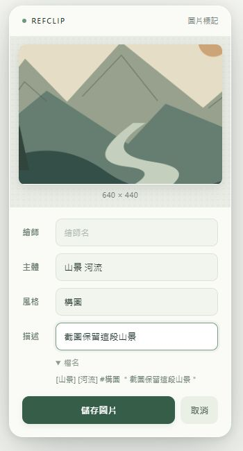

# RefClip｜參考圖收集器

讓創作參考圖的蒐集，像把圖片丟進口袋一樣自然。

RefClip 是一款 Chrome 擴充功能。長按網頁上想收藏的圖片，左右晃動，再拖進出現的投放區，就能為圖片加上標籤並儲存。你可以依自己的習慣調整標籤欄位與命名符號，也能用快捷鍵框選網頁截圖，沿用相同的打標與儲存流程。

目前版本：**0.7.1**。支援 Windows 與 macOS 的 Chrome 109+，以滑鼠／觸控板操作為主。

原名 Shake Save，0.7.1 起更名為 **RefClip｜參考圖收集器**。更新同一個擴充功能資料夾後重新載入即可，既有手勢、標籤及儲存位置會保留。



## 功能

- **晃動收圖**：長按圖片 → 左右晃動 → 拖進投放區 → 放開。投放區出現在手勢觸發時的游標位置，之後固定。
- **縮圖與打標**：保留圖片比例，在下方填寫標籤，再按「儲存圖片」。
- **自訂類別**：預設繪師、主體、風格、描述四欄，可新增、改名、排序、移除，保留 1–12 欄。
- **自訂命名**：每個類別可設定前綴與後綴，也可留空；合法符號依設定原樣使用。
- **歷史提示**：多標籤欄位提供曾用標籤的前綴提示，支援中文組字期間的欄位文字、方向鍵及 Tab 換欄。
- **快捷鍵截圖**：框選部分畫面或擷取整個可見區域，輸出 PNG，接到同一套打標表單。
- **兩種儲存方式**：Chrome 下載子資料夾，或安裝本機輔助程式後指定其他本機資料夾。
- **同名避讓**：自動加入編號，不覆蓋已有圖片。寫入失敗會提示，不自動切換目的地。

原圖收集保留原始格式與位元組，不截圖或重新壓縮，動態 GIF 保留原檔。快捷鍵截圖則儲存當時畫面的 PNG。

## 安裝擴充功能

本專案目前以未封裝項目載入，尚未在 Chrome 線上應用程式商店發布。

1. [下載專案 ZIP](https://github.com/ToNyA-369/refclip/archive/refs/heads/main.zip) 並解壓縮，放到之後不會移動的資料夾；若使用 Git，可執行 `git clone https://github.com/ToNyA-369/refclip.git`。
2. 開啟 `chrome://extensions/`，啟用「開發人員模式」。
3. 按「載入未封裝項目」，選取包含 `manifest.json` 的專案根資料夾。
4. 在工具列固定 RefClip，並重新整理準備收圖的網頁。

**使用下載模式不需安裝其他程式。** Windows 與 macOS 都可直接使用手勢、打標和截圖。預設位置是 Chrome 下載目錄下的 `DrawingReferences`。

想把圖片直接存到下載目錄以外的位置，請依下方步驟安裝對應平台的本機輔助程式。

## 開始收圖

1. 用滑鼠左鍵長按圖片，預設約 **350 ms**。
2. 出現提示後左右晃動，預設幅度約 **24 px**，做兩次有效方向反轉。
3. 在投放區內放開，填寫標籤後按「儲存圖片」。
4. 等待成功通知，再到設定的資料夾確認檔案。

放在區外、按 Esc 或取消表單會放棄本次圖片。工具列彈窗可調整長按時間、晃動幅度與啟停。

## 標籤與檔名

工具列 RefClip → **「儲存位置與標籤設定…」**，可調整類別、前後綴和檔名預覽。修改後按頁面下方「儲存設定」。新開的表單套用新設定，已開啟的表單保留當時的命名方式。

| 預設類別 | 輸入例子 | 加入檔名的內容 |
| --- | --- | --- |
| 繪師 | `繪師甲 繪師乙` | `@繪師甲 @繪師乙` |
| 主體 | `人物 頭` | `[人物] [頭]` |
| 風格 | `手繪 水彩` | `#手繪 #水彩` |
| 描述 | `鼻子的畫法很漂亮 光影值得參考` | `＂鼻子的畫法很漂亮 光影值得參考＂` |

例如：

```text
@繪師甲 @繪師乙 [人物] [頭] #手繪 #水彩 ＂鼻子的畫法很漂亮 光影值得參考＂.png
```

- **多標籤**以空白分隔，同欄重複標籤會去重；每個詞各自套用前後綴。
- **單段文字**保留內部空白，不拆成多個標籤；描述預設使用此方式，也不建立搜尋歷史。
- 每個前後綴最多 12 字元。欄位內只需填內容，程式會加上你設定的符號。
- 前後綴不會自動轉成全形。Windows 不允許半形 `< > : " / \ | ? *` 用於檔名，設定時會要求改用合法符號，例如單引號 `'`、`「 」`、`[ ]`。macOS 本機模式可使用半形雙引號；兩個平台都禁止路徑分隔符號。
- 描述預設的 `＂` 本來就是全形，可自行更換。0.7.0 不會自動修改之前已儲存的設定或圖片。
- 標籤內容中的不合法檔名字元仍會安全替換；前後綴本身不替換。
- 主檔名最多 110 字元，macOS 另有 230 UTF-8 位元組上限，超過會提示縮短，不默默截斷。
- 全部留空會使用時間與來源檔名。副檔名依圖片格式決定，同名檔案自動編號。

每個多標籤類別最多保留 500 個歷史詞，單次最多顯示 6 個提示。用滑鼠、方向鍵＋Enter 套用提示；**Tab／Shift+Tab 切換欄位**，Ctrl+Enter／macOS Command+Enter 可儲存。中文輸入法組字時依欄位已呈現的文字提供提示，不讀取輸入法外部候選視窗。

檔名預覽可選收合、展開或隱藏。動畫遵守系統「減少動畫」偏好。

## 網頁截圖與快捷鍵

| 平台 | 預設按鍵 |
| --- | --- |
| Windows | **Alt+Shift+S** |
| macOS | **Command+Shift+S** |

按快捷鍵後拖曳框選，放開完成；也可按「整個可見區域」。截完直接開啟打標表單，按「儲存圖片」後存入目前設定的位置。Esc 取消。

**更改快捷鍵**：設定頁「網頁截圖」→「自訂截圖快捷鍵」，在開啟的 `chrome://extensions/shortcuts` 找到 RefClip 的「框選網頁截圖並加上標籤」並修改。Chrome 會保存按鍵，重啟後仍保留。返回設定頁可查看實際按鍵；若顯示尚未設定，請指定不與 Chrome、作業系統或其他擴充功能衝突的按鍵。

截圖只包含當前可見的網頁內容，不包含網址列，不自動捲動拼接整頁。框選期間切換分頁／視窗或改變大小會取消。受保護影片可能為黑畫面或無法擷取。

## 自訂本機儲存資料夾

兩種模式都不修改 Chrome 全域下載目錄。下載模式只能設定下載目錄下的相對子資料夾；任意本機位置需要輔助程式。

### Windows

不需管理員權限，不需安裝 Node.js、Python 或 SDK；使用 Windows .NET Framework 4.x 編譯主機。

1. 先在 Chrome 載入擴充功能，再雙擊 **`native\install.cmd`**。
2. 安裝程式嘗試從 Chrome 一般設定檔辨識本專案的 ID；若詢問，從擴充功能設定頁按「複製 ID」並貼入。也可執行 `native\install.cmd 你的32字元ID`。
3. 返回設定頁按「重新檢查連線與位置」→「選擇資料夾」。
4. 確認完整位置，儲存方式選「自訂本機資料夾」，按「儲存設定」。

主機安裝於 `%LOCALAPPDATA%\ShakeSave`，註冊在目前使用者的 `HKCU\Software\Google\Chrome\NativeMessagingHosts\com.shakesave.host`。不建立服務或排程，不支援 UNC 路徑、符號連結或接合點。資料夾完整路徑最多 180 字元。

### macOS

下載模式可直接使用。自訂資料夾模式需 **Python 3.9+**，可使用已安裝的 Python，或從 [Python 官方網站](https://www.python.org/downloads/macos/)安裝。不需第三方 Python 套件，不需 sudo。

1. 先載入擴充功能。在 Terminal 中 `cd` 到專案根資料夾。
2. 執行：

   ```sh
   bash native/macos/install.command
   ```

3. 安裝程式嘗試辨識 Chrome ID；若詢問，從設定頁「複製 ID」並貼入。亦可指定：

   ```sh
   bash native/macos/install.command 你的32字元ID
   ```

4. 返回設定頁「重新檢查連線與位置」→「選擇資料夾」，在 macOS 系統選擇器選定資料夾。
5. 儲存方式改「自訂本機資料夾」，按「儲存設定」。

主機安裝於 `~/Library/Application Support/ShakeSave`，Chrome 註冊檔位於 `~/Library/Application Support/Google/Chrome/NativeMessagingHosts/com.shakesave.host.json`。安裝會記住 Python 的完整路徑；移除或移動 Python 後需重新安裝主機。支援 Intel／Apple Silicon，實際使用對應架構的 Python。

目的地須是可寫入的實際本機資料夾，暫不支援符號連結與不支援硬連結的檔案系統。macOS 如詢問對桌面、文件等位置的存取權限，請依所選資料夾授權；也可改選其他可寫位置。

### 最短驗收

選下載目錄以外的資料夾 → 收一張圖並填標籤 → 等成功通知 → 開啟實際圖片確認位置與檔名 → 關閉所有 Chrome 視窗並重開 → 不重新選資料夾，再收一張。

選定位置與權限失效時會報錯，不改存其他地方。兩個 Chrome 設定檔若在同一系統帳號使用相同擴充功能 ID，會共用本機位置。

## 更新與移除

- **更新擴充功能**：更新同一資料夾，至 `chrome://extensions/` 按「重新載入」，再重新整理原先開啟的網頁。若因新權限停用，確認後重新啟用。
- **Windows 更新主機**：完成收圖、關閉選擇器後重跑 `native\install.cmd`，保留位置。若 EXE 正在使用，關閉 Chrome 再跑。
- **macOS 更新主機**：重跑 `bash native/macos/install.command`，保留位置。
- **Windows 移除主機**：關閉 Chrome，執行 `native\uninstall.cmd`。
- **macOS 移除主機**：關閉 Chrome，執行 `bash native/macos/uninstall.command`。

主機移除會清除該系統帳號的主機註冊與位置設定，**不刪已收藏圖片**。可以保留擴充功能並改回下載模式，或在 Chrome 移除擴充功能。

搬移未封裝專案或換成不同 ID 後，請以目前設定頁的 ID 重新安裝主機。0.7.0 的 Windows 使用者若已安裝既有主機，不需重裝。

## 相容性與限制

- 適用一般 HTTP／HTTPS 網頁。Chrome 設定頁、商店、PDF 檢視器與 `file://` 不支援。
- 支援一般圖片、picture/srcset、SVG 外部 image、單層 CSS 背景圖，以及可讀取的 data／blob 圖片；儲存實際載入來源，不自動找高解析原圖。
- 登入來源、跨站 CDN、過期網址、防盜連或 Cookie 政策可能使讀取失敗。失敗會提示，不模擬登入或繞過網站限制。
- canvas、影片或 inline SVG 無法透過原圖手勢取出；可自行使用快捷鍵截取可見畫面。
- 本機模式與截圖最多 20 MiB，支援 PNG/APNG、JPEG、GIF、WebP、AVIF、SVG、BMP、ICO、TIFF；SVG 含 DTD／外部實體會拒絕。
- iframe 的原圖手勢範圍在該 iframe 內；截圖操作在頂層網頁。網站拖曳機制、頂層對話框及其他擴充功能可能衝突。
- 以滑鼠／觸控板為主，未提供觸控手勢。下載模式可能受 Chrome「每次詢問儲存位置」及安全政策影響。
- macOS 主機已提供實作與測試，但這次交付環境是 Windows，尚未完成 macOS Chrome 選擇器／重啟實機驗收。

## 常見問題

| 問題 | 處理 |
| --- | --- |
| `Extension context invalidated` | 擴充功能已重新載入，但網頁仍使用舊腳本。重新整理網頁；0.7.0 已補上此情況的提示與錯誤處理。 |
| 自訂符號無法儲存 | 檢查作業系統的檔名限制。Windows 半形雙引號無法用於檔名；改用單引號或其他合法符號。設定不再自動轉全形。 |
| 本機程式未連線／host not found | 重跑對應平台的安裝程式，使用目前設定頁 ID，再檢查連線。macOS 確認 Python 仍在原安裝位置。 |
| 尚未選擇資料夾 | 主機已連線，按「選擇資料夾」。 |
| 沒有權限／位置不存在 | 接回磁碟、確認空間與系統資料夾權限，或重新選擇資料夾。 |
| 截圖快捷鍵沒反應 | 到 `chrome://extensions/shortcuts` 確認指定按鍵，保持 Chrome 在前景並重新整理網頁。 |
| 工具列顯示 `!` | 開啟彈窗查看最近截圖錯誤；檢查是否為不支援的特殊頁面。 |
| 本機模式沒有 Chrome 下載紀錄 | 正常；本機模式直接寫入選定資料夾，完整位置及最近結果在設定頁。 |

若檔案完成後、成功回覆前連線中斷，結果可能不明，請先檢查目標資料夾再重試。

## 隱私與權限

沒有 AI、自動分類、雲端上傳或分析追蹤。標籤、設定與最近結果保存在本機；圖片存到你選定的資料夾。擴充功能會向來源圖片網址取回資料，本機主機不連網。

| 權限 | 用途 |
| --- | --- |
| downloads | Chrome 下載模式 |
| storage | 手勢、類別、標籤歷史與最近結果 |
| nativeMessaging | 連接本機圖片儲存主機 |
| activeTab | 你按快捷鍵後擷取目前網頁 |
| HTTP／HTTPS 網站存取 | 辨識頁面圖片與讀取原圖 |

本機主機只提供圖片寫入與資料夾選擇，檢查來源、檔名及傳輸大小，不提供任意指令或任意檔案讀取。詳細安全邊界及測試區分請見 [開發文件](docs/DEVELOPMENT.md)。

## 開發

不需建置，直接修改 JavaScript 後重新載入擴充功能。測試使用 Node.js 18+，macOS 主機測試使用 Python 3.9+：

```sh
node --test tests/*.test.cjs
python3 tests/macos_host_test.py
```

目前本機通過 50 項 JavaScript／Windows 測試，以及 6 項 Python 可攜式測試。[GitHub Actions](https://github.com/ToNyA-369/refclip/actions) 在 Windows／macOS 執行跨平台測試；macOS 已通過 9 項 Python 主機測試，包含真實訊息程序與磁碟寫入。測試頁使用的模擬 Chrome API 不等於 Chrome 實機驗收。完整流程見 [開發文件](docs/DEVELOPMENT.md)。
